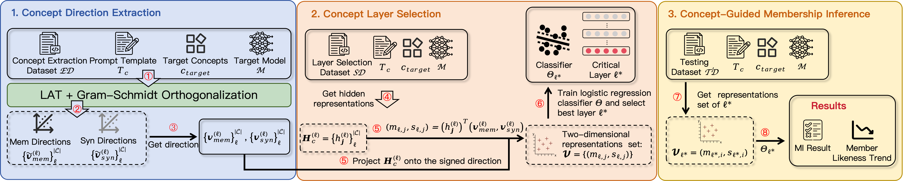

# Membership or Predictability? Characterizing Member-Likeness through Representation Engineering for Code LLM Membership Inference

ReCodeMI is a representation-based membership inference framework for Code LLMs. ReCodeMI leverages Representation Engineering to extract two concept directions: a memory direction that captures training-data exposure and a syntax-familiarity direction that characterizes familiarity with common coding patterns, enabling a more faithful characterization of member-likeness and yielding robust membership signals under semantically equivalent code transformations. 



## Environment

Create and activate the conda environment:

```bash
conda create -n llmia python=3.12 -y
conda activate llmia
```

Install the Python dependencies:

```bash
pip install -r requirements.txt
```

## Data Preparation

Download the raw datasets from Google Drive and place them at the required paths:

```bash
mkdir -p datasets/APPS datasets/stack2

# APPS
gdown https://drive.google.com/file/d/1HSwSfD5lDPEac0bW5mozqdwijGJRj7_S/view?usp=sharing \
  -O datasets/APPS/APPS.jsonl

# the-stack-v2
gdown https://drive.google.com/file/d/1B48BdbXscrgTG_lRFEr7J6d0rQeaH5XB/view?usp=sharing \
  -O datasets/stack2/the-stack-v2-python-90k.jsonl
```

Build all derived datasets with:

```bash
bash experiments/dataset_construction.sh
```

## Basic LAT Run

Run the core LAT pipeline with `main.py`:

```bash
python main.py \
  --fit datasets/stack2/fit.jsonl \
  --validate datasets/stack2/validate.jsonl \
  --test datasets/stack2/test.jsonl \
  --output-dir results/bigcode/starcoder2-7b/stack2 \
  --model bigcode/starcoder2-7b \
  --concept familiarity \
  --stimulus starcoder2-mia-test
```

## Experiments

Run dataset construction first:

```bash
bash experiments/dataset_construction.sh
```

Then run the experiment scripts.

### RQ1

```bash
bash experiments/RQ1/run_trans_code_baseline.sh
```

### RQ2

```bash
bash experiments/RQ2/run_RQ2.sh
```

### RQ3

Run standard ReCodeMIA/LAT:

```bash
bash experiments/RQ3/run_re_mia.sh
```

Run baseline MIA metrics:

```bash
bash experiments/RQ3/run_baseline.sh
```

Run AdvPrompt-MIA + ReCodeMIA:

```bash
bash experiments/RQ3/run_MIA_Adv_add_recodemia.sh
```

Run NaturalCC + ReCodeMIA:

```bash
bash experiments/RQ3/run_naturalcc_add_recodemia.sh
```

The AdvPrompt-MIA script uses the shadow model's validation LAT file by default:

```text
results/sapienzanlp/Minerva-7B-base-v1.0/stack2/LAT_val.json
```

Generate it first with:

```bash
bash experiments/RQ3/run_re_mia.sh \
  0 sapienzanlp/Minerva-7B-base-v1.0
```

### RQ4

```bash
bash experiments/RQ4/run_rq4_ablation.sh
```
